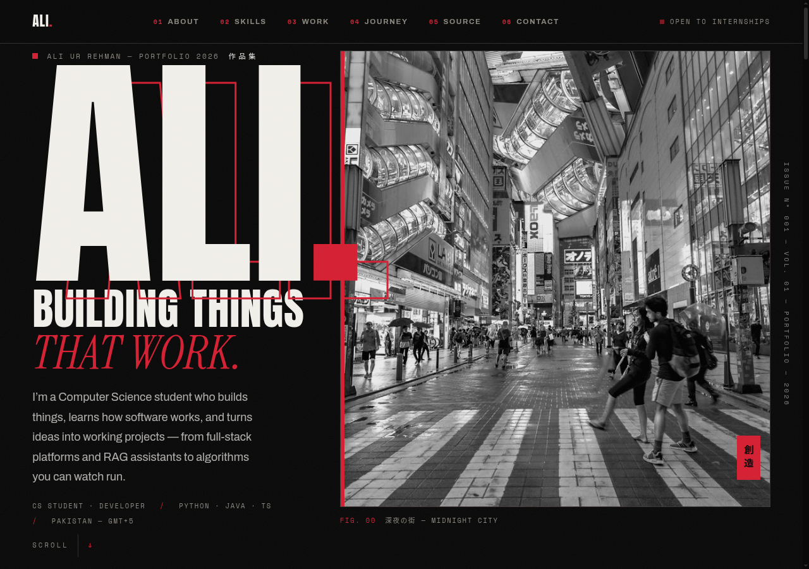
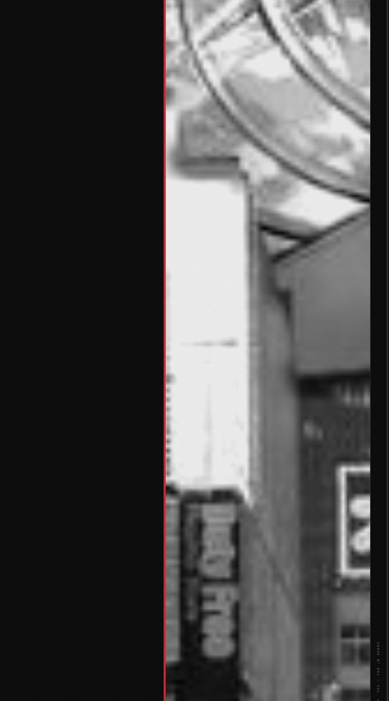

# Web Engineering (CSC 332)

Coursework, notes, and assignment submissions for **Web Engineering** — including a hand-written, JavaScript-free portfolio site published on GitHub Pages.

**Live portfolio:** https://alionit01.github.io/Web_Engineering/

---

## Contents

| Path | What it is |
| --- | --- |
| [`ASS1/portfolio/`](ASS1/portfolio/) | Assignment 1 — personal CV/portfolio site (`index.html`, `style.css`, `assets/`). Source of the GitHub Pages deployment. |
| [`ASS1/A1_Submission/`](ASS1/A1_Submission/) | Assignment 1 submission package: report, submission write-up, project links, and screenshots. |
| [`ASS1/WE A1.docx`](ASS1/WE%20A1.docx), [`ASS1/0-CIS-WE-F26.docx`](ASS1/0-CIS-WE-F26.docx) | Assignment brief and course documents. |
| [`cis/`](cis/) | Course reading material — *Web Communication Technologies — A Starting Guide*. |
| [`learning/html_css/`](learning/html_css/) | Practice pages from HTML/CSS learning exercises. |
| [`.github/workflows/`](.github/workflows/) | GitHub Actions workflow that deploys the portfolio to GitHub Pages. |

## The portfolio

The assignment site lives in `ASS1/portfolio/` and is built with **hand-written HTML and CSS only** — no JavaScript, no framework, no build step.

- **Sections:** About · Skills · Work · Journey · Source · Contact
- **Featured projects:** FYP Finder, RAG Order Assistant, Algorithm Visualizer
- **Typography:** Anton, Archivo, Instrument Serif, Space Mono, Noto Sans JP (Google Fonts)
- **Accessibility & responsiveness:** semantic landmarks, a skip link, `aria-label`ed navigation, and a mobile layout
- **Design:** dark editorial theme with a fixed nav rail, hairline rules, and scroll-reveal animations done purely in CSS

| Home | Work |
| --- | --- |
|  |  |

More screenshots are in [`ASS1/A1_Submission/screenshots/`](ASS1/A1_Submission/screenshots/).

## Deployment (GitHub Pages)

`.github/workflows/deploy-portfolio.yml` publishes `ASS1/portfolio/` to GitHub Pages automatically.

It runs on:

- every push to `main` that changes `ASS1/portfolio/**` or the workflow file itself
- manual runs via **Actions → Deploy Portfolio to GitHub Pages → Run workflow**

To deploy manually or from a fork:

1. **Settings → Pages → Source** → *GitHub Actions*
2. Push to `main` (or trigger the workflow manually)
3. The site appears at `https://<user>.github.io/Web_Engineering/`

## Viewing locally

No tooling required — just open the file:

```bash
# Portfolio (Assignment 1)
xdg-open ASS1/portfolio/index.html   # or: open ASS1/portfolio/index.html

# Learning exercises
xdg-open learning/html_css/index.html
```

Any static file server works too, e.g. `python3 -m http.server` run from inside `ASS1/portfolio/`.

## Course notes

`cis/Application Communication Technologies.md` is the core reading for the assignment. Its central idea: classify web communication technologies by **the problem they solve**, not by product name, walking through

1. communication pattern → 2. API/interaction model → 3. data representation →
4. application/messaging protocol → 5. transport & addressing → 6. cross-cutting concerns (security, reliability, observability)

The written analysis of that reading is in [`ASS1/A1_Submission/Part1_Report_Student.md`](ASS1/A1_Submission/Part1_Report_Student.md), with the condensed version in [`ASS1/A1_Submission/Submission_Student.md`](ASS1/A1_Submission/Submission_Student.md).

## License

Course material and personal work — all rights reserved unless stated otherwise.
